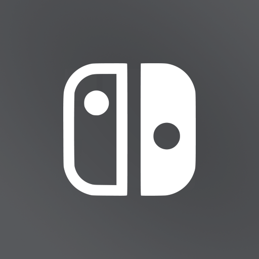
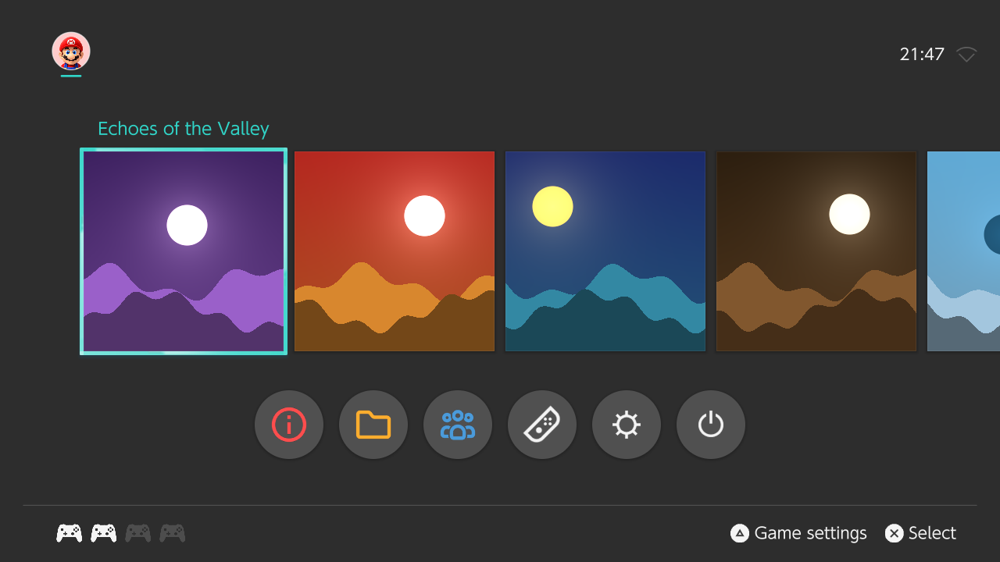
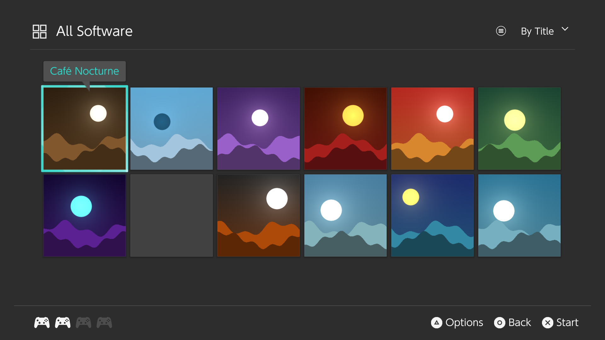
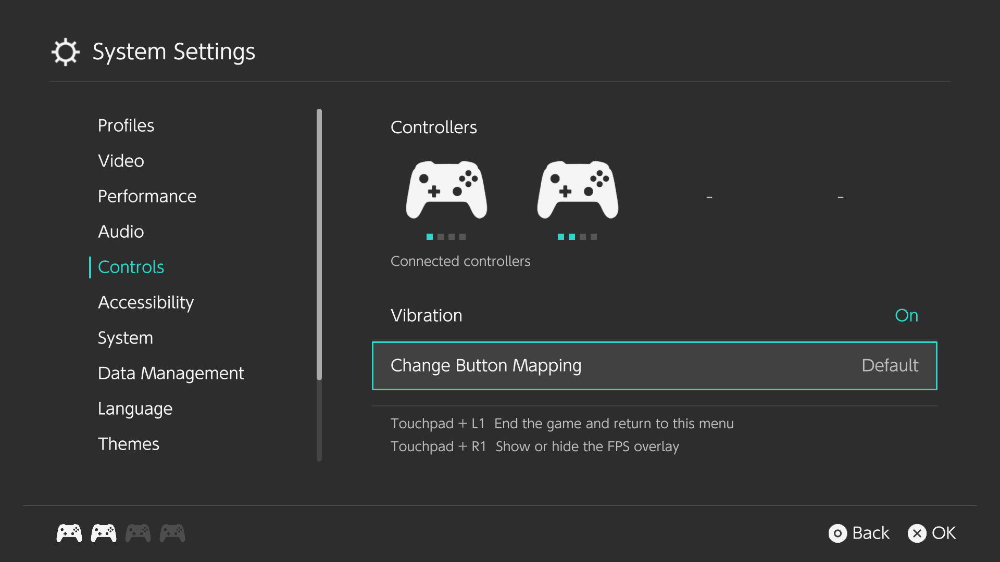
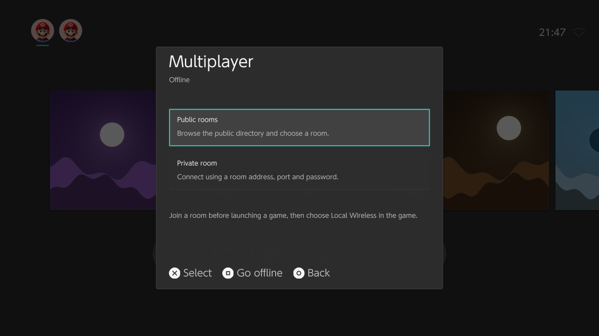

> [!IMPORTANT]
> **SwitchPS5 development has ended.** The project has transitioned to [SwitchLauncher](https://github.com/kasobos67/SwitchLauncher).

<strong>SwitchPS5 or SwitchLauncher?</strong>

 

**SwitchPS5** is a complete emulator app with the Switch-style menus already built in.

**SwitchLauncher** adds those menus to the regular ProsperoEden app. It is the continuation of SwitchPS5.

| Question | [SwitchPS5](https://github.com/kasobos67/SwitchPS5) | [SwitchLauncher](https://github.com/kasobos67/SwitchLauncher) |
|---|---|---|
| **What do I install?** | The complete SwitchPS5 app. Everything needed for its interface is included. | ProsperoEden first, then the SwitchLauncher pack. |
| **Do I need both projects?** | No. SwitchPS5 works on its own. | You need ProsperoEden, but you do not need SwitchPS5. |
| **What do I open on my PS5?** | The **Switch** app. | **ProsperoEden**, with SwitchLauncher selected as its launcher. |
| **Which emulator version does it use?** | The bundled **ProsperoEden 1.005.000**. | Your installed ProsperoEden version. Choose a compatible SwitchLauncher release. |
| **How do I update the menus?** | Updates require replacing the app files manually. **1.005.000 is the final release.** | Download and install SwitchLauncher updates directly from its **About** menu. |
| **Can I use newer ProsperoEden versions?** | Updating regular ProsperoEden does not update the emulator inside SwitchPS5. No further SwitchPS5 updates are planned. | Yes, with a compatible SwitchLauncher release. ProsperoEden and SwitchLauncher are updated separately. |
| **Which one should I choose?** | Choose this if you want the final standalone app and are happy to stay on its bundled emulator version. | **Recommended for new users:** choose this for future menu improvements and support for newer ProsperoEden versions. |

SwitchLauncher changes the interface. Game compatibility and in-game performance depend on the ProsperoEden version and settings you use.

  

<h1 align="center">SwitchPS5</h1>

SwitchPS5 brings a Nintendo Switch-style interface to [ProsperoEden](https://github.com/blackbearreloaded/ProsperoEden) on PlayStation 5. It combines a familiar HOME screen, software library, settings screens, and multiplayer menu with the underlying ProsperoEden emulation platform.

The project focuses on the user interface, navigation, launcher integration, branding, package identity, and update handling. Emulation capabilities and game compatibility depend on the upstream components included in each build. See the release notes for the upstream version, changes, tested features, and known limitations of a particular release

## Features

- **Nintendo Switch-inspired interface** — A redesigned launcher based on the Nintendo Switch HOME menu, featuring familiar navigation, animations, artwork, and sounds.
- **HOME screen** — A console-style landing screen for browsing and launching games.
- **Software library** — Browse installed games through a Switch-inspired library layout.
- **System settings** — Access emulator configuration through the customized settings interface.
- **Multiplayer menu** — A dedicated interface for ProsperoEden's experimental multiplayer functionality.
- **Custom assets** — Switch-inspired icons, backgrounds, fonts, animations, and sound effects.
- **ProsperoEden backend** — Uses the upstream emulator's game execution core, graphics renderers, controller support, and compatibility improvements.
- **Independent installation** — Installs separately from ProsperoEden, allowing both applications to coexist on the same console.

Game compatibility and emulation performance depend on the underlying ProsperoEden version and the individual game.

## Screenshots

These launcher previews use placeholder games and profiles.

Some upstream interface features have intentionally been excluded to maintain the SwitchPS5 experience.

- **Automatic updates are disabled.** Updating directly through ProsperoEden's built-in updater could replace the custom interface with the original upstream UI. SwitchPS5 must therefore be updated manually.
- **Theme support has been removed.** SwitchPS5 uses its own dedicated interface and does not support switching to ProsperoEden's themes.
- **The entire ProsperoEden layout has been removed.** SwitchPS5 retains its custom Nintendo Switch-inspired HOME screen, library, settings, and navigation instead of adopting the redesigned upstream launcher.
- The PS5 app is named **Switch** and uses title ID **PPSA99009**

## Source Code

SwitchPS5 is a modified version of ProsperoEden.
The project retains the upstream emulation backend while implementing a separate Nintendo Switch-inspired frontend and application identity.
The source includes selected artwork, fonts, motion data, and sounds extracted from decrypted Nintendo Switch firmware.
No complete Nintendo Switch firmware, encryption keys, game dumps, or save data are provided with the project.
For upstream emulator development, technical documentation, and build information, refer to the [ProsperoEden repository](https://github.com/blackbearreloaded/ProsperoEden).

## Credits

ProsperoEden creator: **[BlackBearReloaded](https://github.com/blackbearreloaded/ProsperoEden)**.\
Emulator core: [Eden and contributors](https://github.com/eden-emulator/mirror).

SwitchPS5 is an unofficial homebrew project and is not affiliated with, endorsed by, or sponsored by Nintendo, Sony Interactive Entertainment, or the original emulator developers.\
Nintendo Switch, PlayStation, and all associated trademarks belong to their respective owners.\
This project is intended for lawful use with games and files you own and have obtained legally. Piracy and the distribution of copyrighted game files, firmware, or encryption keys are not supported.\
SwitchPS5 is experimental software provided without warranty. Compatibility, stability, and performance may vary.

Use at your own risk.
