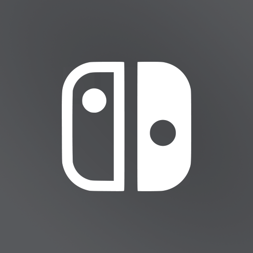
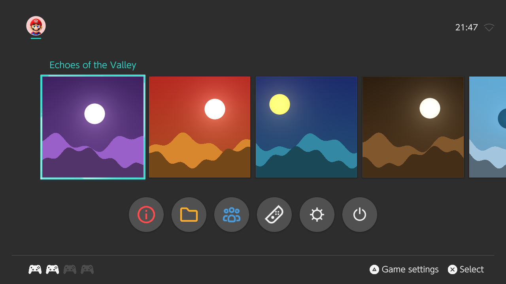
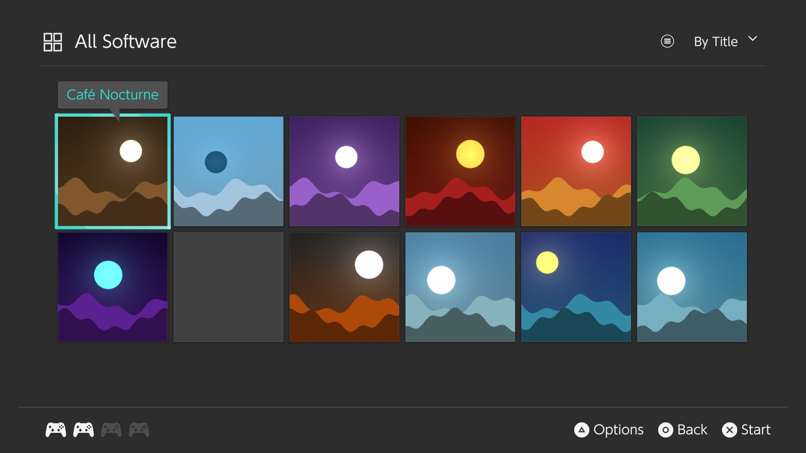
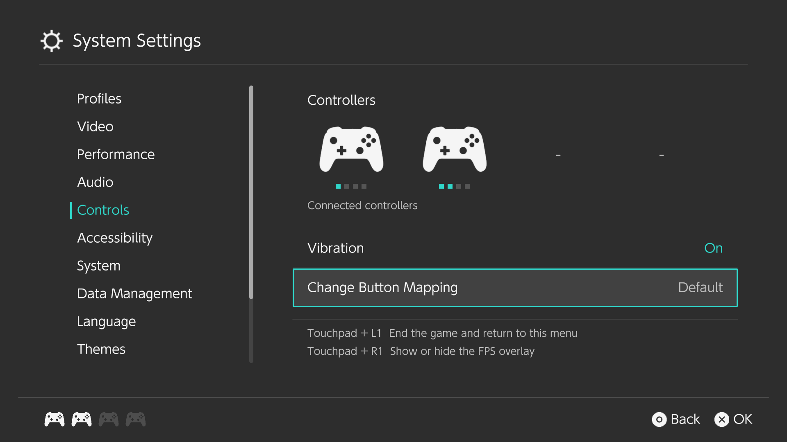
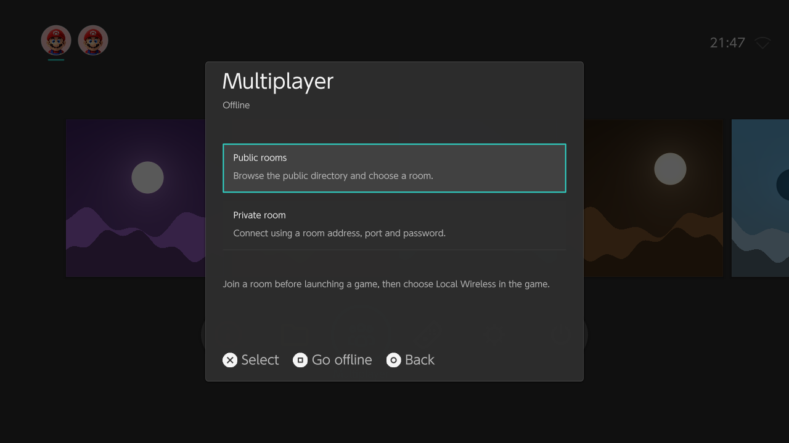

  

<h1 align="center">SwitchPS5</h1>

SwitchPS5 brings a Nintendo Switch-style interface to [ProsperoEden](https://github.com/blackbearreloaded/ProsperoEden) on PlayStation 5. It combines a familiar HOME screen, software library, settings screens, and multiplayer menu with the underlying ProsperoEden emulation platform.

The project focuses on the user interface, navigation, launcher integration, branding, package identity, and update handling. Emulation capabilities and game compatibility depend on the upstream components included in each build. See the release notes for the upstream version, changes, tested features, and known limitations of a particular release

## Screenshots

These launcher previews use placeholder games and profiles.

The PS5 app is named **Switch** and uses title ID **PPSA99009**, changed from the upstream app. You can install it on its own or alongside ProsperoEden. Both use the established `/data/prosperoeden` folder for games, settings, keys, firmware, and saves, so switching between the apps does not require moving that data.

The **emulation engine and game execution core are unchanged from ProsperoEden**. This project changes the UI, its launcher integration, branding, package identity, and update behavior. The UI uses selected art, fonts, motion data, and sounds extracted from decrypted Switch firmware. No complete firmware, keys, game dumps, or saves are included.

ProsperoEden creator: **[BlackBearReloaded](https://github.com/blackbearreloaded/ProsperoEden)**. Emulator core: [Eden and contributors](https://github.com/eden-emulator/mirror). See the [release notes](https://github.com/kasobos67/SwitchPS5/releases/tag/1.002.000), the upstream credits, and the source licenses. This is unofficial and is not affiliated with Nintendo or Sony.
